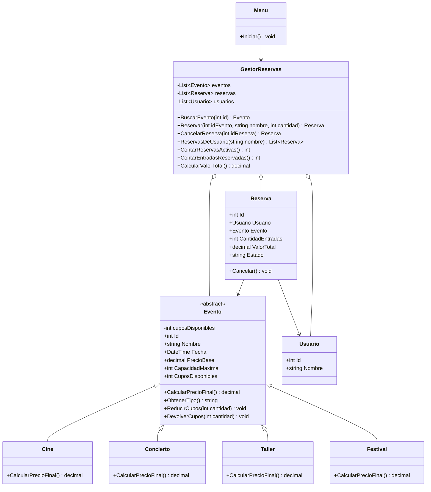

# PLANAZO - Eventos y reservas (POO en C#)

Parcial individual de Programación con C# y .NET. Es una aplicación de consola para ver eventos, reservar entradas, controlar los cupos y cancelar reservas.

## Descripción

PLANAZO organiza conciertos, funciones de cine y talleres. Con esta aplicación se pueden consultar los eventos, reservar entradas a nombre de una persona, cancelar reservas y ver un resumen. Cuando se reserva se descuentan los cupos y cuando se cancela se devuelven. Si el usuario escribe algo mal (letras en vez de números, una cantidad negativa, un evento que no existe) el programa muestra un mensaje de error y sigue funcionando.

## Funcionalidades

- 7 eventos al iniciar: 2 de cine, 2 conciertos, 2 talleres y 1 festival (reto 1).
- Menú con las opciones: ver eventos, consultar evento, reservar, ver reservas, cancelar reserva, ver resumen y ver reservas de un usuario (reto 2).
- El precio final depende del tipo de evento:
  - Cine: precio base.
  - Concierto: precio base + 15 %.
  - Taller: precio base - 10 %.
  - Festival: precio base + 25 % + $8.000.
- Los valores de dinero se manejan con `decimal`.

## Cómo ejecutar

Se necesita tener instalado el [SDK de .NET](https://dotnet.microsoft.com/download).

```bash
git clone https://github.com/TU-USUARIO/PLANAZO-POO-CSharp.git
cd PLANAZO-POO-CSharp
dotnet run
```

## Estructura del proyecto

```text
PLANAZO-POO-CSharp/
├── Program.cs
├── PLANAZO.csproj
├── Modelos/
│   ├── Evento.cs
│   ├── Cine.cs
│   ├── Concierto.cs
│   ├── Taller.cs
│   ├── Festival.cs
│   ├── Usuario.cs
│   └── Reserva.cs
├── Servicios/
│   ├── GestorReservas.cs
│   └── Menu.cs
├── Capturas/
├── README.md
└── .gitignore
```

## Clases y cómo se relacionan

- **Evento (clase abstracta):** tiene lo que tienen todos los eventos (id, nombre, fecha, precio base, capacidad y cupos) y los métodos para quitar y devolver cupos. Tiene el método abstracto `CalcularPrecioFinal()`.
- **Cine, Concierto, Taller y Festival:** heredan de `Evento` y cada una calcula el precio a su manera.
- **Usuario:** representa a la persona que reserva (id y nombre).
- **Reserva:** une a un usuario con un evento. Guarda la cantidad de entradas, el valor total y el estado (Activa o Cancelada).
- **GestorReservas:** tiene las listas de eventos (`List<Evento>`), reservas (`List<Reserva>`) y usuarios (`List<Usuario>`). Crea y cancela reservas, busca las reservas de un usuario y calcula el resumen.
- **Menu:** muestra el menú, pide los datos al usuario y captura los errores con `try/catch`.
- **Program:** solo crea el gestor y el menú y arranca el programa.

Relaciones: el `GestorReservas` tiene muchos eventos, reservas y usuarios; cada `Reserva` apunta a un `Evento` y a un `Usuario`; y `Cine`, `Concierto`, `Taller` y `Festival` heredan de `Evento`.

## Diagrama UML (reto 3)



## Dónde usé cada concepto de POO

- **Encapsulamiento:** en `Evento` el campo `cuposDisponibles` es privado. Solo se puede cambiar con `ReducirCupos()` y `DevolverCupos()`. En `Reserva`, el `Estado` solo cambia dentro de la clase con `Cancelar()` (usa `private set`).
- **Abstracción:** `Evento` es una clase `abstract`, así que no se puede crear un evento "genérico". Obliga a las clases hijas a escribir `CalcularPrecioFinal()`.
- **Herencia:** `Cine`, `Concierto`, `Taller` y `Festival` heredan de `Evento` y reutilizan sus propiedades y su constructor con `: base(...)`.
- **Polimorfismo:** en `Reserva` se calcula `ValorTotal = evento.CalcularPrecioFinal() * cantidad`. No importa qué tipo de evento sea, cada uno responde con su propio precio.
- **Constructores:** inicializan los objetos y validan los datos (por ejemplo, el precio y la capacidad deben ser mayores que cero).
- **Colecciones:** `List<Evento>`, `List<Reserva>` y `List<Usuario>` en `GestorReservas`.
- **Excepciones:** se lanzan con `throw new Exception(...)` cuando la cantidad es inválida, no hay cupos, el evento no existe o la reserva ya estaba cancelada. El `Menu` las captura con `try/catch`.

## Casos de prueba

Todos se pueden probar desde el menú con `dotnet run`.

| # | Caso | Cómo probarlo | Resultado esperado |
| --- | --- | --- | --- |
| 1 | Reserva válida | Opción 3, evento 3, 2 entradas | Reserva creada, total $115.000 |
| 2 | Más entradas que cupos | Opción 3, evento 5, 25 entradas | Error: no hay cupos suficientes |
| 3 | Cantidad negativa | Opción 3, cantidad -3 | Error: la cantidad debe ser mayor que cero |
| 4 | Cancelar devuelve cupos | Opción 5 y luego opción 2 del mismo evento | Los cupos vuelven al valor inicial |
| 5 | Cancelar dos veces | Opción 5 con la misma reserva | Error: ya estaba cancelada |
| 6 | Evento inexistente | Opción 2 con id 99 | Error: no existe el evento |
| 7 | Precio por tipo | Opción 1 | Cine $15.000, Concierto $57.500, Taller $72.000, Festival $133.000 |

## Capturas de las pruebas

Las capturas de los 7 casos están en la carpeta `Capturas/`.

## Retos realizados

- **Reto 1 (nuevo tipo de evento):** clase `Festival`. No se modificó ninguna de las otras clases de eventos.
- **Reto 2 (gestión de usuarios):** clase `Usuario` y la opción 7 del menú, que muestra todas las reservas de una persona.
- **Reto 3 (UML):** el diagrama de arriba.

## Pregunta de sustentación

**¿Por qué utilizaste una clase abstracta `Evento` en lugar de crear clases completamente independientes para Cine, Concierto y Taller? ¿Qué ventajas tiene esta decisión cuando necesitamos agregar un nuevo tipo de evento?**

Usé una clase abstracta porque Cine, Concierto y Taller tienen casi todo igual: id, nombre, fecha, precio base, capacidad y cupos. Lo único que cambia es cómo se calcula el precio final. Si hubiera hecho tres clases separadas, tendría que repetir los mismos atributos y los métodos `ReducirCupos()` y `DevolverCupos()` tres veces, y si hubiera un error habría que corregirlo en los tres sitios. Con la clase `Evento` ese código está una sola vez y cada clase hija solo escribe su propio precio, por ejemplo:

```csharp
public class Concierto : Evento
{
    public override decimal CalcularPrecioFinal()
    {
        return PrecioBase * 1.15m;
    }
}
```

Como el método es `abstract`, C# obliga a cada tipo de evento a escribirlo, entonces no se puede olvidar.

Otra ventaja es el polimorfismo: `GestorReservas` guarda todos los eventos en una sola `List<Evento>` y `Reserva` calcula el total con `evento.CalcularPrecioFinal()` sin saber si es un cine, un concierto o un taller.

Por eso, cuando agregué el `Festival` (reto 1) solo tuve que crear una clase nueva que hereda de `Evento` y añadir un `new Festival(...)` a la lista. No fue necesario cambiar `Reserva`, ni el menú, ni las otras clases, y el festival ya se podía reservar y cancelar.
