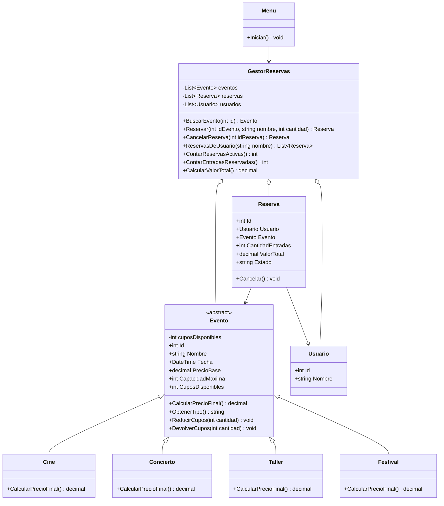

# PLANAZO-POO-CSharp

Proyecto del parcial de **Programación con C# y .NET**. Es un programa de consola que simula el sistema de reservas de PLANAZO, una empresa que organiza funciones de cine, conciertos y talleres.

## ¿De qué trata el proyecto?

La idea es que una persona pueda entrar al programa, mirar los eventos que hay, escoger uno y apartar entradas. El programa lleva la cuenta de cuántos cupos quedan: los quita cuando alguien reserva y los vuelve a poner si la reserva se cancela. Si el usuario se equivoca (escribe letras donde van números, pide una cantidad negativa o busca un evento que no existe), el programa avisa del error y sigue funcionando en lugar de cerrarse.

## Qué puede hacer

Al abrir el programa aparece un menú con estas opciones:

1. Ver eventos disponibles
2. Consultar un evento
3. Reservar entradas
4. Ver las reservas realizadas
5. Cancelar una reserva
6. Ver el resumen de reservas (cuántas hay activas, cuántas entradas y cuánto dinero suman)
7. Ver las reservas de una persona
0. Salir

Empieza con siete eventos ya cargados: dos de cine, dos conciertos, dos talleres y un festival.

### Cómo se calcula el precio

| Tipo | Regla | Ejemplo |
| --- | --- | --- |
| Cine | Se cobra el precio base | $15.000 → $15.000 |
| Concierto | Precio base más 15 % | $50.000 → $57.500 |
| Taller | Precio base menos 10 % | $80.000 → $72.000 |
| Festival | Precio base más 25 % y $8.000 de servicio | $100.000 → $133.000 |

Todo el dinero está guardado con el tipo `decimal`.

## Cómo correrlo

1. Instalar el [SDK de .NET](https://dotnet.microsoft.com/download).
2. Descargar o clonar el repositorio.
3. Abrir una terminal dentro de la carpeta del proyecto y escribir:

```bash
dotnet run
```

## Organización de los archivos

```text
PLANAZO-POO-CSharp/
├── Program.cs
├── PLANAZO.csproj
├── Modelos/
│   ├── Evento.cs
│   ├── Cine.cs
│   ├── Concierto.cs
│   ├── Taller.cs
│   ├── Festival.cs
│   ├── Usuario.cs
│   └── Reserva.cs
├── Servicios/
│   ├── GestorReservas.cs
│   └── Menu.cs
├── Capturas/
├── README.md
└── .gitignore
```

La carpeta `Modelos` tiene los objetos del sistema (eventos, usuarios y reservas). La carpeta `Servicios` tiene la parte que hace funcionar el programa: el gestor con las reglas y el menú con el que se interactúa. `Program.cs` solo arranca todo.

## Las clases una por una

**Evento.** Es la clase "madre" de todos los eventos. Guarda el identificador, el nombre, la fecha, el precio base, la capacidad máxima y los cupos disponibles. También sabe quitar y devolver cupos. Es abstracta, es decir, nunca se crea un evento a secas: siempre es de un tipo concreto.

**Cine, Concierto, Taller y Festival.** Son las clases "hijas". Cada una toma todo lo de `Evento` y solo agrega su propia forma de calcular el precio final.

**Usuario.** Representa a la persona que reserva, con su número y su nombre.

**Reserva.** Junta a un usuario con un evento. Guarda cuántas entradas se pidieron, cuánto cuesta en total y si está activa o cancelada. Al crearla quita los cupos del evento, y al cancelarla los devuelve.

**GestorReservas.** Es el "cerebro". Tiene las listas de eventos, reservas y usuarios, y hace el trabajo: buscar un evento, crear una reserva, cancelarla, sacar las reservas de una persona y calcular el resumen.

**Menu.** Se encarga de hablar con el usuario: muestra las opciones, pide los datos y muestra los resultados o los errores.

**Cómo se conectan:** el `Menu` usa al `GestorReservas`; el gestor guarda los eventos, las reservas y los usuarios; cada reserva apunta a un evento y a un usuario; y los cuatro tipos de evento salen de `Evento`.

## Diagrama de clases (UML)



## Conceptos de POO y dónde se ven en el código

- **Clases y objetos:** los eventos, los usuarios y las reservas son objetos creados a partir de sus clases.
- **Constructores:** cada clase recibe sus datos al crearse. `Evento` además revisa que el precio y la capacidad sean mayores que cero.
- **Encapsulamiento:** los cupos de un evento están en un campo privado. Para cambiarlos hay que pasar por `ReducirCupos()` o `DevolverCupos()`, que revisan que todo sea válido. El estado de la reserva solo lo cambia la propia reserva en `Cancelar()`.
- **Abstracción:** `Evento` es abstracta y obliga a que cada tipo de evento defina `CalcularPrecioFinal()`.
- **Herencia:** `Cine`, `Concierto`, `Taller` y `Festival` heredan de `Evento` y no repiten sus atributos ni sus métodos.
- **Polimorfismo:** al crear una `Reserva` se hace `evento.CalcularPrecioFinal() * cantidad`. Esa línea sirve para cualquier tipo de evento y cada uno responde con su propio precio.
- **Asociaciones y composición:** la reserva está asociada a un evento y a un usuario; el gestor contiene las listas con todo.
- **Colecciones:** `List<Evento>`, `List<Reserva>` y `List<Usuario>`.
- **Excepciones:** el programa lanza un error cuando la cantidad es cero o negativa, cuando faltan cupos, cuando no existe el evento o la reserva, o cuando se cancela dos veces. El menú los atrapa con `try/catch` y muestra el mensaje.

## Pruebas

Las pruebas se hacen desde el menú, ejecutando `dotnet run`.

| # | Qué se prueba | Qué hacer | Qué debe pasar |
| --- | --- | --- | --- |
| 1 | Reserva válida | Opción 3, evento 3, 2 entradas | Se crea la reserva por $115.000 |
| 2 | Más entradas que cupos | Opción 3, evento 5, 25 entradas | Sale un error por falta de cupos |
| 3 | Cantidad negativa | Opción 3, con -3 entradas | Sale un error de cantidad inválida |
| 4 | Cancelar devuelve cupos | Cancelar con la opción 5 y mirar el evento con la opción 2 | Los cupos vuelven a su valor inicial |
| 5 | Cancelar dos veces | Opción 5 con la misma reserva | Sale un error porque ya estaba cancelada |
| 6 | Evento inexistente | Opción 2 con el id 99 | Sale un error de evento no encontrado |
| 7 | Precio de cada tipo | Opción 1 | Cine $15.000, Concierto $57.500, Taller $72.000, Festival $133.000 |

Las capturas de estas pruebas están en la carpeta `Capturas/`.

## Retos adicionales

- **Reto 1, nuevo tipo de evento:** se agregó `Festival` sin modificar `Cine`, `Concierto`, `Taller` ni la lógica de las reservas.
- **Reto 2, gestión de usuarios:** se creó la clase `Usuario` y la opción 7 del menú muestra todas las reservas de una persona.
- **Reto 3, UML:** el diagrama de clases está en este README.

## Pregunta de sustentación

**¿Por qué utilizaste una clase abstracta `Evento` en lugar de crear clases completamente independientes para Cine, Concierto y Taller? ¿Qué ventajas tiene esta decisión cuando necesitamos agregar un nuevo tipo de evento?**

Los tres tipos de evento son casi iguales: todos tienen identificador, nombre, fecha, precio base, capacidad y cupos, y todos se reservan y se cancelan de la misma manera. Lo único que cambia es la cuenta del precio final. Por eso puse todo lo repetido en una sola clase, `Evento`, y dejé que cada tipo escriba únicamente lo que lo hace distinto. Por ejemplo, el concierto solo necesita esto:

```csharp
public class Concierto : Evento
{
    public override decimal CalcularPrecioFinal()
    {
        return PrecioBase * 1.15m;
    }
}
```

Si hubiera hecho tres clases separadas, habría copiado los mismos atributos y los mismos métodos de cupos tres veces, y cualquier arreglo habría que repetirlo en cada una. Además, como `CalcularPrecioFinal()` es abstracto, C# obliga a que cada clase nueva lo escriba, así que nadie se puede olvidar de definir su precio.

También ayuda al polimorfismo. `GestorReservas` guarda todos los eventos en una sola lista de tipo `Evento` y `Reserva` calcula el total con `evento.CalcularPrecioFinal()` sin preguntar de qué tipo es el evento.

Gracias a esto, agregar el `Festival` fue sencillo: se creó una clase nueva que hereda de `Evento` y se añadió a la lista de eventos. No hubo que tocar `Reserva`, el menú ni las demás clases, y el festival ya se podía reservar y cancelar.
